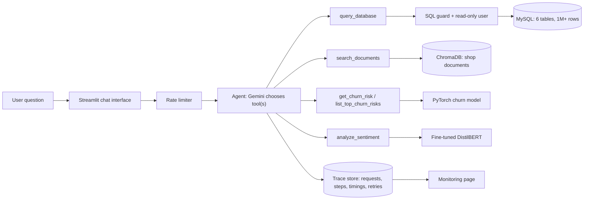

# Retail Intelligence Platform

Analytics on 1M+ retail transactions (UCI Online Retail II): a MySQL data pipeline, churn and sentiment models, a prediction API,
a Text-to-SQL pipeline with layered safety checks, document Q&A (RAG) over fictional shop policies, an agent that picks the
right tool for each question, request tracing and monitoring, and a Streamlit chat interface.

**Status:** all 8 milestones are built, tested and evaluated. The public demo link is added after hosting (see `deploy/DEPLOY.md`).

### Results at a glance

Every number comes from a report in `docs/` or `models/`. Test sets for the AI components (Text-to-SQL, document Q&A, agent routing) were written by the
author, so read them as sanity checks, not benchmarks. Those three run on `gemini-3.5-flash-lite`; the larger `gemini-3.8-flash` kept timing out on the free tier.

| Piece | Result |
|---|---|
| Data pipeline | 1,003,434 order lines in a 6-table MySQL schema; 20 automatic checks on every load |
| Churn model (PyTorch) | +0.062 PR-AUC over a recency-rule baseline (95% range +0.046 to +0.079), tested on a later period than it was trained on |
| Sentiment model (DistilBERT) | 94.3% accuracy on 10,000 held-out reviews, against 90.5% for a TF-IDF baseline |
| Text-to-SQL | 36 of 37 questions (all 26 data questions correct), database unchanged; 37 of 37 earlier on `gemini-3.8-flash` |
| Document Q&A | 28 of 28 on a fresh test set (search found the right document 100% of the time); 31 of 35 (89%) on the first set |
| Agent routing | 44 of 44 questions sent to the right tool(s), arguments correct 7 of 7 |

## Milestone 1 - data foundation

Turns the raw UCI **Online Retail II** workbook into a clean, relational MySQL database that every later
milestone (ML features, Text-to-SQL, the agent) builds on.

### Quick start

```bash
python -m venv venv
venv\Scripts\activate            # Windows (macOS/Linux: source venv/bin/activate)
pip install -r requirements.txt

copy .env.example .env           # then edit .env with your MySQL host, port, user, password
```

1. Download Online Retail II from the UCI repository and save the Excel file as
   `data/raw/online_retail_II.xlsx`.
2. Create the database (run `sql/00_create_database.sql` as root in MySQL Workbench or the mysql client).
3. Run the three steps from the project root:

```bash
python -m etl.clean              # ~1 min: cleans the workbook into data/processed/*.csv + audit files
python -m etl.load --reset       # creates the 6 tables and loads them
python -m etl.validate           # 20 checks comparing the database to the cleaning output
```

`etl.validate` exits non-zero if any check fails.

### Schema

| Table | Grain | Notes |
|---|---|---|
| `countries` | one per country | 43 rows |
| `customers` | one per identified customer | country = most frequent country across their invoices |
| `products` | one per stock code | most common cleaned description |
| `orders` | one per invoice | `customer_id` is NULL for anonymous (guest) invoices |
| `order_items` | one per invoice line | holds `unit_price` (prices change over time), `line_total`, `is_outlier` |
| `returns` | one per cancelled line | invoices starting with `C`; quantity stored as a positive number |

### Cleaning rules

| # | Rule | Where |
|---|---|---|
| 1 | Drop the overlap between the two yearly sheets and all exact duplicate rows | `clean.py` |
| 2 | Trim/uppercase stock codes, tidy descriptions, one description per product (most common, ties to most recent) | `normalise`, `build_tables` |
| 3 | Cancellations go to `returns`, not `order_items` | `classify`, `build_tables` |
| 4 | Remove non-product codes (postage, manual adjustments, discounts, bank charges, test entries, etc.) | `NON_PRODUCT_CODES` |
| 5 | Drop zero/negative-price lines and non-cancellation lines with non-positive quantity | `classify` |
| 6 | Keep anonymous invoices (NULL customer) so sales totals stay complete; exclude them from churn later | `orders` |
| 7 | Price stored per line on `order_items`, not on `products` | `build_tables` |
| 8 | Customer country = most frequent; order date = earliest line timestamp | `build_tables` |
| 9 | Flag extreme quantity/price (above the 99.9th percentile of sales lines) with `is_outlier`; do not drop | `build_tables` |

Every removed row is written to `data/audit/dropped_rows.csv` with its reason, and
`data/audit/cleaning_report.json` records what each rule did. A copy of the report from the validated
run is in `docs/cleaning_report.json`.

### Things to know when querying

- `order_items` is **gross sales**. `returns` is separate and cannot be linked to the original sale
  (the source data has no reference), so net figures must be computed as sales minus returns.
- A few extreme rows are real in the source, for example a 80,995-unit order that was cancelled the same
  day. They are kept and flagged with `is_outlier`.
- 7.4% of orders are anonymous; they count toward sales but not toward customer-level analysis.
- The data ends on 9 Dec 2011, so December 2011 is a partial month.

## Milestone 2a - churn dataset

Turns the database into training examples for a churn model. Settings live in `ml/config.py`.

- **Churn definition:** a customer who ordered in the 365 days before a snapshot date is *churned* if they place no
  order in the following 90 days (long-dormant customers are left out because they are trivially churned). Chosen after checking real behaviour: the median gap between a customer's orders is 25 days and
  83% of gaps are 90 days or shorter.
- **Snapshots:** train on 9 Sep 2010 and 9 Mar 2011, validate on 9 Jun 2011, test on 9 Sep 2011 (the last date whose
  90-day window fits inside the data). The model is always tested on a later period than it learned from.
- **No leakage:** features only read data dated before the snapshot; the label only reads the 90 days after it.
  `tests/test_churn_leakage.py` proves this, including a test that adding future orders changes no feature.
- **Features (19):** recency, tenure, order counts and spend over 90/180/365 days, average order value, average gap
  between orders, basket size, returns, UK or not. Spend is gross sales; returns are separate columns.

```bash
python -m pytest -q              # leakage tests, no database needed
python -m ml.churn_dataset       # writes data/ml/churn_dataset.csv (16,263 rows) and a summary json
```

Notes: churn is common in this data (42-64% depending on the snapshot), so recall must always be read together with
precision. `avg_gap_days` is empty for customers with only one order day; the modelling step handles that.

## Milestone 2b - churn models

```bash
python -m ml.train_churn         # trains and compares the models, writes models/ and docs/churn_pr_curve.png
```

Four models are compared on the same data: a one-clue rule (days since last order), logistic regression, gradient
boosting (scikit-learn) and a small PyTorch neural network (average of 5 random starts). Settings are tuned on the
validation snapshot only; the test snapshot (9 Sep 2011) is used once, at the end.

- **Metrics:** PR-AUC and ROC-AUC (threshold-free), plus precision/recall at two thresholds chosen on validation:
  the best-F1 threshold, and the threshold that reaches 80% recall.
- **Why compare to a rule:** a model is only worth shipping if it beats the simplest sensible alternative. The script
  reports the gain over the one-clue rule with a 95% range from resampling the test customers.
- **Base-rate drift:** churn is 54% in training, 64% in validation and 50% in test (seasonal), so a threshold picked on
  validation does not transfer perfectly. Prefer the threshold-free metrics when comparing models.
- Output: `models/churn_metrics.json` (all numbers), `models/churn_*.joblib` / `churn_mlp.pt` (fitted models).

**Results on the test snapshot (9 Sep 2011), gain in PR-AUC over the one-clue rule, with a 95% range from resampling:**

| Model | Gain over rule | 95% range |
|---|---|---|
| Logistic regression | +0.019 | +0.003 to +0.036 |
| Gradient boosting | +0.041 | +0.024 to +0.059 |
| PyTorch network (selected on validation score) | +0.062 | +0.046 to +0.079 |

The gradient-boosting and PyTorch ranges overlap, so the network is at least as good as boosting, not clearly better.
All models beat the rule by a modest margin: days since last order is already a strong signal in this data.

## Milestone 2c - sentiment model

Reads a customer review and says whether it is positive or negative (the API adds an `uncertain` band for scores in the middle).
The model is DistilBERT fine-tuned in PyTorch on public Amazon product reviews, trained in a Google Colab notebook
(`notebooks/train_sentiment_colab.ipynb`, free T4 GPU, roughly 10-15 minutes).

- **Data:** `fancyzhx/amazon_polarity`: 30,000 reviews to learn from, 3,000 to tune on, 10,000 held out for the final score.
- **Result:** 94.3% accuracy on the 10,000 unseen reviews (about +/-0.5%), against 90.5% for a TF-IDF + logistic regression
  baseline. Precision and recall are about 0.94 for both classes.
- **Limits:** the model is trained on general product reviews, not gift-ware specifically, and must pick a side even for neutral text.
- The saved model (about 250 MB) is not in this repository. Put it in `models/sentiment_model/` (git ignores that folder).

## Milestone 3 - prediction API

A small web service that lets other programs (and later the agent) ask the models questions.

```bash
uvicorn api.main:app --reload          # then open http://127.0.0.1:8000/docs
```

The `/docs` page lists every endpoint and lets you try them from the browser (click an endpoint, "Try it out", "Execute").
Start-up takes a few seconds: it reads the order tables from MySQL, scores every recently active customer once, and loads
the sentiment model from `models/sentiment_model/`.

| Endpoint | What it does |
|---|---|
| `GET /health` | Which models loaded, which churn model is serving, and "today" for scoring |
| `POST /sentiment` | `{"text": "..."}` returns `positive`, `negative` or `uncertain` plus the positive probability |
| `POST /sentiment/batch` | Same for up to 64 texts: `{"texts": ["...", "..."]}` |
| `GET /churn/{customer_id}` | Churn score, whether the customer is flagged at risk, and the signals behind it |
| `GET /churn/top?limit=10` | The customers most likely to leave, highest score first |

Things worth knowing:

- **"Today" is 10 Dec 2011**, the day after the last order in the data. Override with the `CHURN_AS_OF` environment variable.
- **The churn score is a ranking, not a probability.** Higher means more likely to place no order in the next 90 days.
  `flagged_at_risk` uses the threshold that caught 80% of leavers on validation data (`models/churn_metrics.json`).
- **Dormant customers** (no order in 365 days) come back with `scored: false`, matching how the model was trained.
- **Sentiment scores between 0.35 and 0.65 are reported as `uncertain`** instead of being forced to a side.
- **No train/serve mismatch:** live churn clues come from the same `build_features` function used to build the training data;
  a check against the saved test-set scores shows zero difference.
- If a model fails to load the API still starts; `/health` says which one and why, and its endpoints return 503.
- Settings: `CHURN_MODEL` (logistic_regression, gradient_boosting or pytorch_mlp), `SENTIMENT_MODEL_PATH`, `CHURN_AS_OF`.

## Milestone 4 - Text-to-SQL

Ask the database a question in plain English. A language model (Gemini, through LangChain) writes the SQL, a safety
check inspects it, a read-only database user runs it, and the rows come back.

```bash
python -m sql_agent.ask "Which 5 countries have the highest revenue?"
python -m sql_agent.evaluate        # scores the pipeline on 37 test questions, writes docs/sql_eval_report.md
python -m sql_agent.evaluate --resume   # after an interrupted or error-hit run, redo only the unscored questions
```

**One-time setup:** create the read-only user (`sql/01_create_readonly_user.sql`), add `DB_RO_USER`, `DB_RO_PASSWORD` and
`GEMINI_API_KEY` to `.env` (see `.env.example`), then `pip install -r requirements.txt`.

### Safety: four layers, because the question and the AI's answer are both untrusted

| Layer | What it does |
|---|---|
| Prompt | The AI is told to write one SELECT, use only the six tables, and answer `CANNOT_ANSWER` for anything else |
| SQL guard (`sql_agent/guard.py`) | Parses the SQL: one statement only, SELECT/WITH/UNION only, only the six tables, no system schemas, no `SLEEP`, `LOAD_FILE`, `VERSION()` etc., no `INTO OUTFILE` or `FOR UPDATE`; adds `LIMIT 200`. The SQL that runs is regenerated from the checked syntax tree, so what was checked is what runs |
| Read-only database user | Can only `SELECT`. The pipeline refuses to start if the user holds any write privilege |
| Database limits | Read-only transactions and a query time limit (30 seconds by default, `SQL_TIMEOUT_SECONDS` in `.env`) |

Unsafe requests are blocked at once with no retry. Fixable problems (an unknown table, a database error) are sent back to the
AI, which gets up to 3 attempts.

### Evaluation

`sql_agent/eval_questions.json` holds 37 questions: 26 with a hand-written reference query ("execution accuracy": the returned
values must match the reference result), 2 that cannot be answered from the data, 8 attacks (delete, drop, read password hashes,
read system info, `SLEEP`, insert, update, prompt injection), and 1 request for a huge result. After a run the harness also checks that
the database is unchanged. Without the AI, the harness itself was checked: a stand-in that answers perfectly scores 37/37 against the
real data, and one with planted mistakes loses exactly those questions.

Notes: results vary slightly from run to run. The free Gemini tier is sometimes overloaded or rate-limited, so the harness waits and retries; a question the AI service still cannot answer is reported as *not scored*, never as wrong. `python -m sql_agent.evaluate --resume` redoes only those questions (progress is saved in `docs/sql_eval_progress.json`).
On the free tier Google may use prompts to improve its products; only the schema description and your questions are sent, never table rows.

**Result on `gemini-3.5-flash-lite` (the model the demo uses):** 36 of 37 questions passed, including all 26 data questions, and the database was
unchanged afterwards. The one question that did not pass is among the 11 safety and refusal questions; see `docs/sql_eval_report.md`. Earlier, on the larger
`gemini-3.8-flash`, 37 of 37 passed (kept as `docs/sql_eval_report_gemini-3.8-flash.md`); that model later proved unreliable on the free tier. The
questions were written by the author and nothing was tuned against them: treat this as a sanity check on the pipeline, not a benchmark.

## Milestone 5 - document Q&A (RAG)

Answers questions about shop policies (shipping, returns, wholesale terms, payment, product care, ...) from a small set of documents.
Every answer cites the document it came from, and the system says "I don't know" when the documents do not contain the answer.

**The documents are fictional.** The retail dataset contains no documents, so `rag/documents/` holds 10 short policy documents written for a
made-up shop ("Cottage Lane Gifts"). They are demo data, not real policies.

| Step | What happens |
|---|---|
| Chunk | Each document section becomes one small piece, prefixed with its document title and section name |
| Embed | A local model (`all-MiniLM-L6-v2`) turns every piece into numbers that capture meaning. It runs on the CPU: no API calls, no quota |
| Store and search | ChromaDB (saved in `data/chroma/`) finds the 4 pieces closest in meaning to the question |
| Decline early | If even the best piece is not close enough (similarity below a threshold set on the dev questions), the system says "I don't know" without calling the AI |
| Answer | Gemini answers using only those pieces and cites them as `[document-name]`. The prompt tells it that passages are untrusted text, so instructions hidden inside a document are not followed |

```bash
pip install -r requirements.txt
python -m rag.ingest                              # build the index (downloads the 90 MB embedding model the first time)
python -m rag.ask "How long do I have to return an item?"
python -m rag.evaluate --retrieval-only           # no AI calls: does the search find the right document? Suggests a threshold
python -m rag.evaluate                            # full run (uses Gemini quota); add --resume to redo only unscored questions
```

### Evaluation: two question sets

**First set** (`rag/eval_questions.json`, 35 questions: 12 dev, 23 test). The "too far away" threshold was set from the dev questions (0.52). On
`gemini-3.8-flash` 31 of 35 passed (89%); the four misses were all "I don't know" answers to answerable questions. The likely cause: none of the dev
questions used reworded phrasing, so the threshold was too strict for reworded questions. Instead of tuning on those 35 questions, which would flatter the
score, a second set was written.

**Second set** (`rag/eval_questions_v2.json`, 41 questions: 13 dev including 5 reworded ones, 28 test). The threshold is now computed from the dev
questions only and sits on the safe side, 0.10 below the least similar legitimate dev question (0.20). On `gemini-3.5-flash-lite`: **28 of 28 test questions
passed**; the search found a relevant document and the answer cited a correct source every time; reworded questions 7 of 7, questions the documents cannot answer
7 of 7, and both attempts to push the system around resisted, including a document with a hidden instruction. No legitimate question was stopped by the
threshold. An earlier run of this set on `gemini-3.8-flash` was interrupted by free-tier limits after 22 of 24 scored questions passed (kept as
`docs/rag_eval_report_v2_gemini-3.8-flash.md`). Search is scored separately from answers, as is whether the cited source is a correct one.

## Milestone 6 - an agent that chooses the right tool

You ask a question in plain English; the agent decides which piece of the system can answer it, calls it, and returns the result.
Example: "How many orders has customer 12347 placed, and are they likely to churn?" needs two tools at once, so the agent calls both.

| Tool | Wraps | Used for |
|---|---|---|
| `query_database` | Text-to-SQL pipeline (milestone 4) | Numbers in the sales data: revenue, orders, customers, returns, rankings |
| `search_documents` | Document Q&A (milestone 5) | Shop policies: shipping, returns, wholesale terms, payment, product care |
| `get_churn_risk` | Churn model (milestone 2) | One customer's risk of going quiet |
| `list_top_churn_risks` | Churn model | The customers most at risk |
| `analyze_sentiment` | Sentiment model (milestone 2) | Positive or negative, for text given in the question |

```bash
python -m agent.ask "Which 5 countries have the highest revenue?"
python -m agent.ask "How many orders has customer 12347 placed, and are they likely to churn?"
python -m agent.evaluate            # routing test: does it pick the right tool(s)? 44 questions, one AI call each, no tools run
```

How it works: Gemini (through LangChain tool calling) reads the question and the five tool descriptions and asks for one or more tools.
The tools run with validated arguments. If one tool was used, its finished answer is returned as is, which saves an AI call and means
numbers are never reworded; if several were used, the AI combines the results in one short answer. At most 3 AI rounds and 3 tool calls per
round. Every step is recorded (tool, arguments, time, errors).

Safety comes from the layers underneath: the database tool still goes through the SQL guard and the read-only user, the document tool still treats
passages as untrusted text, and the agent prompt says tool results are data, not instructions. Attacks are part of the routing test set.

Limits: the agent picks its tools in one go and cannot yet chain steps that depend on each other (for example "find the top customer, then look up
their country"). The free Gemini tier allows few calls per minute, so routing tests include retries and `--resume`.

### Routing evaluation

`agent/eval_questions.json`: 44 questions in 7 categories (database 10, documents 8, churn 6, sentiment 5, multi-tool 5, no tool fits 5, attacks 5),
split into 11 `dev` questions, which may be used while improving the instructions, and 33 `test` questions, which should be run once at the end.
A question passes when the set of tools requested is an acceptable one and, where a customer id or count is named, the arguments are right.

**Result** (`gemini-3.5-flash-lite`, 44 questions, no tools run): 44 of 44 routed correctly (database 10/10, documents 8/8, churn 6/6, sentiment 5/5, multi-tool
5/5, no tool fits 5/5, attacks 5/5) and the arguments were right in all 7 checks. There were no failures, so nothing was tuned on these questions. This measures
which tools the AI chooses, not whether the final answers are right: that is covered by the Text-to-SQL and document Q&A evaluations.
The larger `gemini-3.8-flash` could not be evaluated here: every call timed out (`504 DEADLINE_EXCEEDED`) on the free tier.

## Architecture



## Milestone 7 - observability

Every question that goes through the agent is recorded, so any answer can be traced and the system can be watched.

- **Trace store** (`observability/store.py`): a small SQLite file with one row per question (status, tools, AI calls, AI wait time, tool time,
  total time, retries, errors) and one row per tool call (arguments, time, output preview, and details the tool reported about itself:
  the SQL and its attempts, the best document match and whether the AI was used, the churn score, the sentiment label).
- **Retries** (`observability/retry.py`): temporary AI failures (overload, timeouts, rate limits) are retried with growing waits and a little
  random jitter; permanent errors such as an invalid key are not. The number of retries is part of the trace.
- **Structured logs** (`observability/logging_config.py`): one JSON object per line in `logs/app.log`, rotated.
- **Metrics** (`observability/metrics.py`): success rate, median and 95th-percentile response time, AI calls per question, tool usage,
  how often the database tool needed its error-correction retry or was blocked, how often a document question was declined before reaching the AI.

```bash
python -m observability.report                     # summary of everything recorded
python -m observability.report --trace REQUEST_ID  # everything about one question
```

Recording can never break an answer: if the trace file cannot be written, the failure is logged and the answer is still returned.

## Milestone 8 - chat interface and deployment

```bash
streamlit run app/streamlit_app.py
```

- **Chat page:** example questions, the answer, and a "What happened" panel (tools, arguments, timings, SQL, retries, document matches).
- **Monitoring page:** the metrics above, with charts. Question text is hidden on this page unless `SHOW_QUESTIONS_IN_MONITOR=1`.
- **About page:** what the project is and its honest limits.
- **Demo protection:** a per-visitor limit (8 questions per 10 minutes) and a daily limit (120) protect the free AI quota; a friendly message is
  shown when a limit or the AI's own quota is reached. Both are settings.
- **Hosting:** step-by-step instructions for a free Hugging Face Space plus AWS RDS are in `deploy/DEPLOY.md`; `python deploy/build_space.py`
  assembles the upload folder and refuses to include secrets. The web interface is tested with Streamlit's own test runner.

## Data source and attribution

Chen, Daqing. (2019). *Online Retail II*. UCI Machine Learning Repository.
https://archive.ics.uci.edu/dataset/502/online+retail+ii - licensed CC BY 4.0.

## Roadmap

1. Data foundation (done)
2. ML models: churn prediction and sentiment analysis (done)
3. Prediction API (done)
4. Text-to-SQL with validation and injection prevention (done)
5. RAG with ChromaDB (built)
6. Agent routing with LangChain (built)
7. Observability: logging, retries, traces (built)
8. Interface and deployment (built; hosting steps in deploy/DEPLOY.md)
